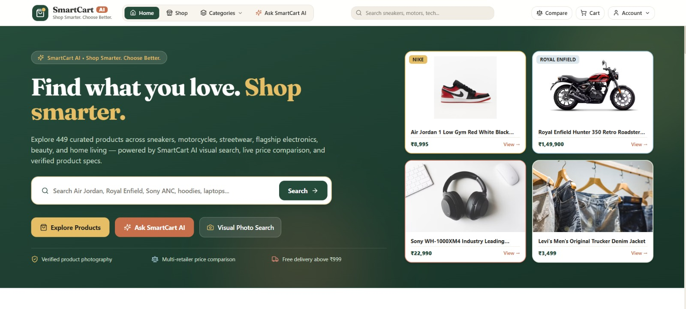
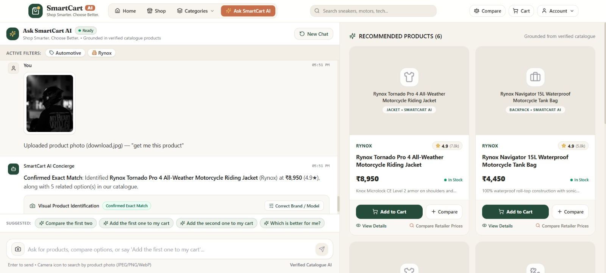
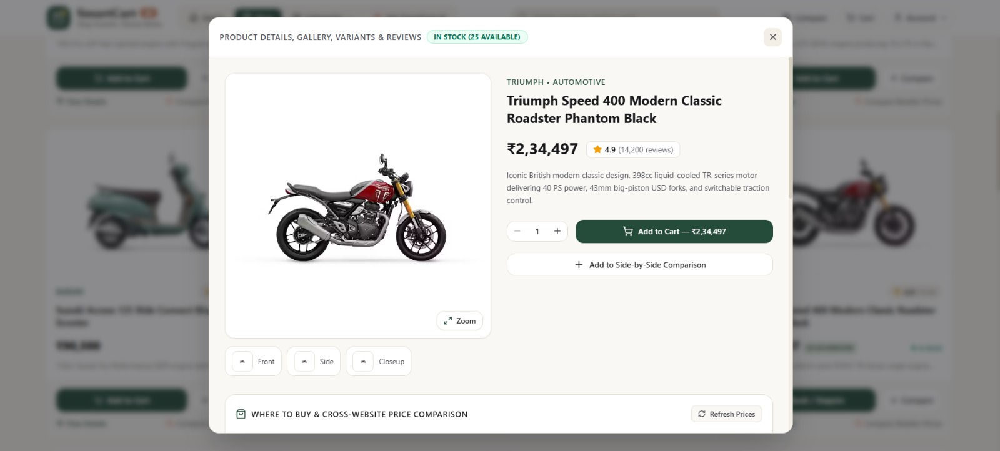

# SmartCart AI 🛍️

**Shop Smarter. Choose Better.**

SmartCart AI is an AI-powered shopping assistant designed to make online shopping smarter, simpler, and more personalized. It combines intelligent product discovery, natural-language shopping assistance, visual product search, and product comparisons in one intuitive interface.

Users can explore a curated catalogue of products, discover items based on their budget and needs, compare product specifications, and find suitable alternatives with the help of AI.

### ✨ Key Features
- 🤖 **AI Shopping Assistant** — Discover products through natural-language conversations.
- 🔎 **Smart Product Search** — Find products by name, brand, category, budget, and use case.
- 📸 **Visual Product Search** — Explore product matches using images.
- ⚖️ **Product Comparison** — Compare prices and available specifications.
- 🛍️ **Shopping Cart** — Add products and manage selected variants.
- 👗 **Diverse Product Catalogue** — Browse sneakers, fashion, electronics, motorcycles, and more.
- 🖼️ **Product Image Mapping** — Display product-specific images for a better browsing experience.
- 💰 **Budget-Friendly Discovery** — Find relevant options based on your spending limit.
- 🔗 **Retailer Search Links** — Explore products on external shopping platforms.

### 🛠️ Tech Stack
- **Frontend:** React, Vite, Tailwind CSS
- **Backend:** Node.js, Express, TypeScript
- **Database:** SQLite
- **AI Integration:** Google Gemini

SmartCart AI aims to bridge the gap between traditional product browsing and intelligent shopping assistance by helping users discover, understand, and compare products more efficiently.

## 📸 Project Screenshots

### Screenshot 1

### Screenshot 2

### Screenshot 3

